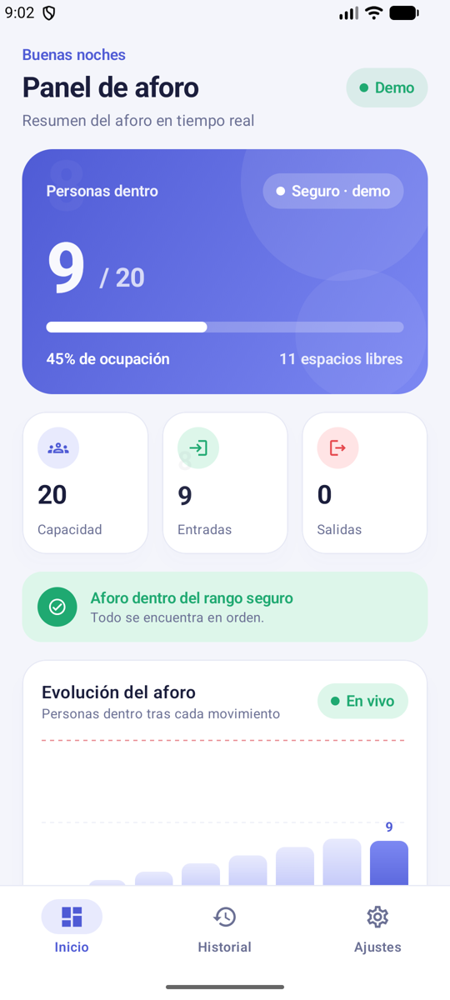
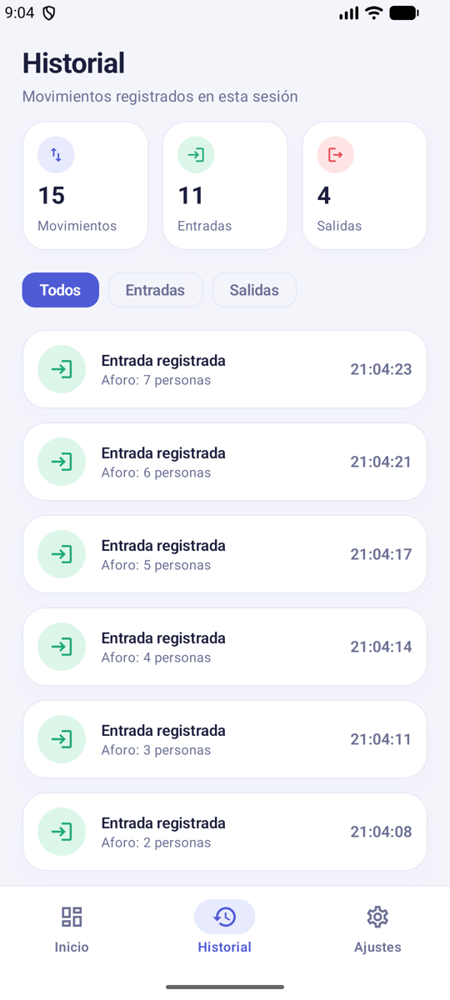
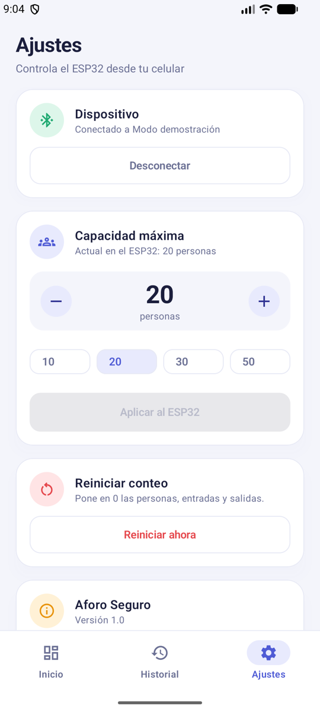

# Aforo Seguro

Sistema de control de aforo con **ESP32**, dos sensores ultrasónicos y una **app Android** conectada por **Bluetooth**.
El prototipo cuenta las personas que entran y salen de un local, muestra el aforo en un LCD, avisa con LEDs y buzzer cuando se llena, y permite verlo y controlarlo desde el celular, sin internet ni cuentas.

> Proyecto del curso **Investigación e Innovación Tecnológica** · Equipo 4 · Tecsup 2026

<p align="center">
  
  
  
  
</p>

## Cómo funciona

```
[HC-SR04 exterior]──┐
                    ├──► ESP32 ◄──── Bluetooth ────► App "Aforo Seguro"
[HC-SR04 interior]──┘      │
                           └──► LCD 16x2 I2C · LED verde · LED rojo · buzzer
```

- **Sentido del paso:** si se activa primero el sensor de afuera es una **entrada**; si se activa primero el de adentro, una **salida**.
- **Indicadores:** LED verde mientras hay espacio y LED rojo con alarma sonora al llegar al aforo máximo.
- **App:** muestra el aforo en tiempo real, guarda el historial de movimientos y envía órdenes al ESP32: cambiar el aforo máximo o reiniciar el conteo.

## Funciones de la app

| Pantalla | Qué ofrece |
|---|---|
| **Inicio** | Personas dentro, % de ocupación, espacios libres, estado (Seguro / Alerta / Lleno), entradas, salidas y gráfico de la evolución del aforo |
| **Historial** | Cada entrada y salida con su hora, con resumen y filtros |
| **Ajustes** | Conexión con el dispositivo, aforo máximo y reinicio del conteo |
| **Alertas** | Notificación en el celular cuando el local se llena |
| **Modo demostración** | Simula el ESP32 con el mismo protocolo, para probar la app sin el prototipo |

## Estructura del repositorio

```
AforoSeguro/
├── app/                     App Android (Kotlin + Jetpack Compose)
├── gradle/                  Configuración de Gradle y versiones
├── esp32/AforoSeguro/       Código del ESP32 (Arduino), comentado
├── docs/
│   ├── GUIA.md              Puesta en marcha paso a paso, pines y pruebas
│   └── capturas/            Capturas de la app
├── build.gradle.kts
└── settings.gradle.kts
```

La raíz del repositorio **es** el proyecto de Android Studio: se abre directamente con *File → Open*.

## Tecnologías

| Parte | Tecnología |
|---|---|
| Microcontrolador | ESP32 DevKit (Arduino core 3.x), `BluetoothSerial`, `Preferences`, `LiquidCrystal_I2C` |
| Sensores y actuadores | 2 × HC-SR04, LCD 16x2 I2C, LEDs, buzzer activo |
| App | Kotlin, Jetpack Compose, Material 3, Navigation, ViewModel + StateFlow (MVVM) |
| Comunicación | Bluetooth clásico SPP con un protocolo de texto propio |
| Pruebas | JUnit: niveles de aforo, protocolo y simulador |

## Protocolo Bluetooth

| Sentido | Mensaje | Significado |
|---|---|---|
| ESP32 → App | `ESTADO;8;20;12;4` | personas; máximo; entradas; salidas |
| ESP32 → App | `EVENTO;ENTRADA;9` / `EVENTO;SALIDA;8` | Movimiento y aforo resultante |
| App → ESP32 | `MAX;15` | Cambiar el aforo máximo |
| App → ESP32 | `RESET` | Reiniciar el conteo |

## Puesta en marcha rápida

1. **ESP32:** abre `esp32/AforoSeguro/AforoSeguro.ino` en el Arduino IDE, elige `ESP32 Dev Module` y súbelo. Necesita la librería *LiquidCrystal I2C*.
2. **Emparejar:** en el celular ve a Ajustes → Bluetooth y toca **AforoSeguro**.
3. **App:** abre la carpeta del repositorio en Android Studio y pulsa **Run ▶** con el celular conectado por USB.
4. **Conectar:** en la app pulsa **Conectar por Bluetooth** y elige AforoSeguro.

Los pines, el divisor de voltaje, el uso con un módulo HC-05 y la tabla de pruebas están en **[docs/GUIA.md](docs/GUIA.md)**.

## Equipo

Equipo 4 · Investigación e Innovación Tecnológica · Tecsup 2026
