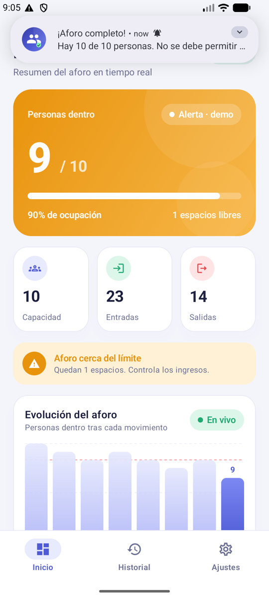

# Aforo Seguro

Sistema de control de aforo con **ESP32**, dos sensores ultrasónicos **HC-SR04** y una **app Android** conectada por **Bluetooth**.
El prototipo cuenta las personas que entran y salen de un local, muestra el aforo en un LCD, avisa con LEDs y buzzer cuando se llena, y permite verlo y controlarlo desde el celular, **sin internet ni cuentas**.

> Proyecto del curso **Investigación e Innovación Tecnológica** · Equipo 4 · Tecsup 2026

<p align="center">
  
  
  
  
</p>

---

## 1. Cómo funciona el sistema

```
        PUERTA DEL LOCAL
   afuera  │          │  adentro
           │          │
 [HC-SR04 EXTERIOR] [HC-SR04 INTERIOR]
           └────┬─────┘
                ▼
             ESP32  ◄──────── Bluetooth ────────►  App "Aforo Seguro" (celular)
                │
                ├──► LCD 16x2 I2C   "Aforo: 8/20"  "SEGURO 40%  BT"
                ├──► LED verde      (hay espacio)
                ├──► LED rojo       (lleno)
                └──► Buzzer         (alarma)
```

1. **El ESP32 detecta el sentido del paso** con dos sensores colocados uno tras otro en la puerta:
   - Se activa primero el **exterior** y luego el **interior** → **entrada** (+1).
   - Se activa primero el **interior** y luego el **exterior** → **salida** (−1).
   - Un sensor "ve" a alguien cuando hay un objeto a **menos de 50 cm**. Si entre un sensor y el otro pasan más de **1.5 s**, el paso se descarta. El ESP32 también espera a que la puerta quede libre antes de contar a la siguiente persona.
2. **El ESP32 muestra el resultado** en el LCD y en los LEDs, y hace sonar el buzzer al llegar al máximo. **Funciona solo, aunque la app no esté conectada.**
3. **La app se conecta por Bluetooth** y recibe el aforo en tiempo real. Desde ella se puede **cambiar el aforo máximo** o **reiniciar el conteo**, y el ESP32 responde al instante.

---

## 2. Materiales

| Componente | Cantidad | Uso |
|---|---|---|
| ESP32 DevKit (WROOM-32, 30 o 38 pines) | 1 | Controlador y Bluetooth integrado |
| Sensor ultrasónico HC-SR04 | 2 | Detectar entradas y salidas |
| Pantalla LCD 16x2 con módulo I2C | 1 | Mostrar el aforo |
| LED verde y LED rojo | 1 c/u | Indicadores de estado |
| Resistencias 220 Ω | 2 | Para los LEDs |
| Resistencias 1 kΩ y 2 kΩ | 2 c/u | Divisores de voltaje de los ECHO |
| Buzzer activo 5 V | 1 | Alarma sonora |
| Protoboard, cables dupont y cable USB de datos | — | Conexiones y alimentación |
| *(Opcional)* Módulo Bluetooth HC-05 | 1 | Si no se usa el Bluetooth integrado |

> ⚠️ Debe ser un **ESP32 clásico** (WROOM / DevKit). Los modelos **ESP32-S3 y ESP32-C3 no tienen Bluetooth clásico** y la app no podría conectarse.

---

## 3. Conexiones

| Componente | Pin del componente | Pin del ESP32 |
|---|---|---|
| **HC-SR04 exterior** | VCC | VIN (5 V) |
| | TRIG | **GPIO 5** |
| | ECHO | **GPIO 18** *(con divisor de voltaje)* |
| | GND | GND |
| **HC-SR04 interior** | VCC | VIN (5 V) |
| | TRIG | **GPIO 19** |
| | ECHO | **GPIO 23** *(con divisor de voltaje)* |
| | GND | GND |
| **LCD 16x2 I2C** | VCC | VIN (5 V) |
| | SDA | **GPIO 21** |
| | SCL | **GPIO 22** |
| | GND | GND |
| **LED verde** | Ánodo (pata larga) → resistencia 220 Ω | **GPIO 25** |
| **LED rojo** | Ánodo (pata larga) → resistencia 220 Ω | **GPIO 26** |
| **Buzzer** | + | **GPIO 27** |
| LEDs y buzzer | − / cátodo | GND |

### Divisor de voltaje en cada ECHO (obligatorio)
El HC-SR04 responde con **5 V**, pero los pines del ESP32 aceptan **3.3 V**. Sin el divisor, el ESP32 se puede dañar.

```
ECHO ──[ 1 kΩ ]──┬──► GPIO 18 (o GPIO 23)
                 │
              [ 2 kΩ ]
                 │
                GND
```

### Alimentación
- El ESP32 se alimenta por **USB** (computadora, cargador de celular o power bank).
- El pin **VIN** entrega esos 5 V a los sensores y al LCD.
- **Todos los GND van unidos.**
- Si el buzzer suena muy débil, actívalo con un transistor NPN (2N2222): base → resistencia de 1 kΩ → GPIO 27, colector → (−) del buzzer, emisor → GND y (+) del buzzer → 5 V.

### Montaje en la puerta
- El sensor **exterior** va del lado de **afuera** y el **interior** del lado de **adentro**, separados **15 a 20 cm** y a la altura de la cintura.
- Los dos deben apuntar al paso de la gente, en paralelo y sin obstáculos delante (el marco, una pared cercana).

---

## 4. Programar el ESP32

1. Instala el **Arduino IDE 2**.
2. En **Archivo → Preferencias → Gestor de URLs adicionales**, agrega:
   `https://espressif.github.io/arduino-esp32/package_esp32_index.json`
3. En **Herramientas → Placa → Gestor de placas**, instala **esp32 de Espressif Systems** (versión 3.x).
4. En **Herramientas → Administrar bibliotecas**, instala **LiquidCrystal I2C** (de Frank de Brabander).
5. Abre **`esp32/AforoSeguro/AforoSeguro.ino`**.
6. En **Herramientas → Placa**, elige **ESP32 Dev Module**, selecciona el **puerto COM** y pulsa **Subir ➜**.
   *Si se queda en `Connecting....`, mantén presionado el botón **BOOT** del ESP32 hasta que empiece a cargar.*
7. Abre el **Monitor serie** a **115200** baudios. Debe aparecer:
   ```
   Bluetooth listo: AforoSeguro
   ```
8. El LCD muestra `Aforo Seguro / Iniciando...` y luego `Aforo: 0/20`.

### ¿Usan un módulo HC-05 en lugar del Bluetooth integrado?
Al inicio del `.ino`, cambia `#define USAR_HC05 false` por **`true`** y conecta:

| HC-05 | ESP32 |
|---|---|
| VCC / GND | VIN (5 V) / GND |
| TXD | **GPIO 16** |
| RXD | **GPIO 17** *(con divisor de voltaje 1 kΩ / 2 kΩ)* |

En el celular aparecerá como **HC-05** (clave `1234` o `0000`). La app funciona igual. *Con el HC-05, el LCD siempre muestra "BT", porque el módulo no avisa si hay un celular conectado.*

---

## 5. Instalar la app

1. Clona el repositorio:
   ```bash
   git clone https://github.com/juandiegoramosenriquez-sys/AforoSeguro.git
   ```
2. En **Android Studio**: **File → Open** → elige la carpeta **`AforoSeguro`**, que es la raíz del proyecto. Espera a que termine el *Gradle Sync*.
3. En el celular, activa el **modo desarrollador**: **Ajustes → Acerca del teléfono** → toca **7 veces** "Número de compilación".
4. Activa **Opciones de desarrollador → Depuración USB**.
5. Conecta el celular por USB, acepta el aviso, elígelo en la lista de dispositivos y pulsa **Run ▶**.

> **Para otros celulares:** **Build → Generate App Bundles or APKs → Build APK(s)**. Envía `app/build/outputs/apk/debug/app-debug.apk` por WhatsApp o Drive y ábrelo (permite *instalar apps desconocidas*).
>
> El **emulador** de Android Studio no tiene Bluetooth: ahí usa el **modo demostración**.

---

## 6. Conectar el celular con el prototipo

**Solo la primera vez: emparejar**
1. Enciende el ESP32.
2. En el celular ve a **Ajustes → Bluetooth → Vincular nuevo dispositivo**.
3. Toca **AforoSeguro** y acepta si pide confirmar un código.

**Cada vez que uses la app: conectar**
1. Abre **Aforo Seguro**.
2. Pulsa **Conectar por Bluetooth**. La primera vez acepta el permiso de **dispositivos cercanos**.
3. Elige **AforoSeguro** (aparece marcado como *Recomendado*).
4. La app debe mostrar **"En línea"** arriba a la derecha, y el LCD debe mostrar **`BT`** en la esquina inferior derecha.

---

## 7. Qué hace cada parte durante el uso

### En el prototipo

| Situación | LCD (línea 1 / línea 2) | LED verde | LED rojo | Buzzer |
|---|---|---|---|---|
| Hay espacio (< 70 %) | `Aforo: 8/20` / `SEGURO 40%` | Encendido | Apagado | — |
| Cerca del límite (≥ 70 %) | `Aforo: 15/20` / `ALERTA 75%` | Encendido | Apagado | — |
| Se llega al máximo | `Aforo: 20/20` / `LLENO! 100%` | Apagado | Encendido | **3 pitidos** |
| Entra alguien estando lleno | `Aforo: 21/20` / `LLENO! 105%` | Apagado | Encendido | **1 pitido** |
| La app cambia el máximo o reinicia | Se actualiza al instante | — | — | **1 pitido** |
| App conectada | `BT` en la esquina inferior derecha | — | — | — |

- El **aforo máximo** queda guardado en el ESP32 aunque se apague. El **conteo** vuelve a 0 al reiniciarlo.

### En la app

| Pantalla | Qué muestra o permite |
|---|---|
| **Inicio** | Personas dentro, % de ocupación, espacios libres, estado (**Seguro / Alerta / Lleno**, con color), entradas, salidas y el gráfico **Evolución del aforo** |
| **Historial** | Cada entrada y salida con su hora, con resumen y filtros (Todos / Entradas / Salidas) |
| **Ajustes** | Conectar o desconectar, **cambiar el aforo máximo** (− / + o atajos 10, 20, 30, 50) y **reiniciar el conteo** |
| **Notificación** | "¡Aforo completo!" en el celular cuando el local se llena |

> El historial guarda los movimientos **desde que la app se conectó** y se borra al cerrarla.

---

## 8. Cómo se comunican (protocolo Bluetooth)

Cada mensaje es una línea de texto por Bluetooth clásico (SPP).

| Sentido | Mensaje | Significado |
|---|---|---|
| ESP32 → App | `ESTADO;8;20;12;4` | 8 personas, máximo 20, 12 entradas, 4 salidas. Se envía en cada cambio y **cada 2 s** |
| ESP32 → App | `EVENTO;ENTRADA;9` | Alguien entró: ahora hay 9 |
| ESP32 → App | `EVENTO;SALIDA;8` | Alguien salió: ahora hay 8 |
| App → ESP32 | `MAX;15` | Cambiar el aforo máximo a 15 (entre 1 y 999) |
| App → ESP32 | `RESET` | Poner el conteo en 0 |

---

## 9. Prueba completa (y guion para el video)

Graba **el celular y el prototipo en la misma toma**.

| # | Acción | Resultado esperado |
|---|---|---|
| 1 | Conectar la app al ESP32 | App: **En línea** · LCD: `BT` |
| 2 | Pasar la mano por el sensor **exterior → interior** | +1 en el LCD y en la app, y aparece en el Historial |
| 3 | Pasar la mano por el sensor **interior → exterior** | −1 en el LCD y en la app |
| 4 | En **Ajustes**, poner el aforo en **3** y pulsar **Aplicar** | LCD `x/3`, 1 pitido y la app actualizada |
| 5 | Hacer entradas hasta llegar a 3 | LCD `LLENO!`, LED rojo, 3 pitidos, tarjeta roja y notificación |
| 6 | En **Ajustes**, pulsar **Reiniciar ahora** | LCD y app vuelven a 0, 1 pitido |

---

## 10. Solución de problemas

| Problema | Solución |
|---|---|
| El LCD está encendido pero sin letras | Gira el potenciómetro azul de atrás del módulo I2C, o cambia `0x27` por `0x3F` en el `.ino` |
| No cuenta, o cuenta de más | Ajusta `DISTANCIA_DETECCION_CM` (50) y `TIEMPO_MAX_CRUCE_MS` (1500) en el `.ino`, y revisa que nada esté delante de los sensores |
| Cuenta al revés (las entradas restan) | Los sensores están invertidos: intercambia los cables de exterior e interior |
| "AforoSeguro" no aparece en el Bluetooth del celular | Revisa que el Monitor serie diga `Bluetooth listo` y que el ESP32 no sea S3/C3 |
| La lista de la app está vacía | Primero empareja AforoSeguro en los ajustes de Bluetooth del celular |
| "No se pudo conectar" | Acerca el celular, reinicia el ESP32 y vuelve a pulsar Conectar |
| Los botones de Ajustes están apagados | La app no está conectada: conéctate en Inicio o en Ajustes |
| Error al subir: `Failed to connect to ESP32` | Mantén presionado **BOOT** al subir, o usa un cable USB de datos (no solo de carga) |

---

## 11. Estructura del repositorio

```
AforoSeguro/                 ← raíz = proyecto de Android Studio
├── app/                     App Android (Kotlin + Jetpack Compose, MVVM)
├── gradle/                  Configuración de Gradle
├── esp32/AforoSeguro/       Código del ESP32, comentado
├── docs/
│   ├── GUIA.md              Guía paso a paso
│   └── capturas/            Capturas de la app
├── build.gradle.kts
└── settings.gradle.kts
```

| Parte | Tecnología |
|---|---|
| Microcontrolador | ESP32 (Arduino core 3.x) · `BluetoothSerial` · `Preferences` · `LiquidCrystal_I2C` |
| App | Kotlin · Jetpack Compose · Material 3 · Navigation · ViewModel + StateFlow |
| Comunicación | Bluetooth clásico SPP con protocolo de texto propio |
| Pruebas | JUnit: niveles de aforo, protocolo y simulador del ESP32 |

---

**Equipo 4** · Investigación e Innovación Tecnológica · Tecsup 2026
